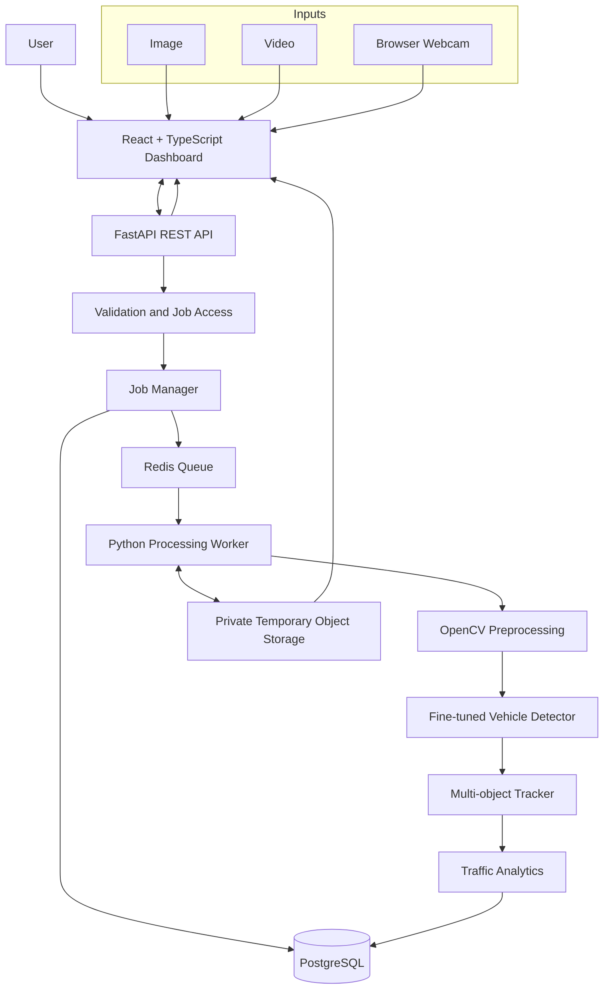
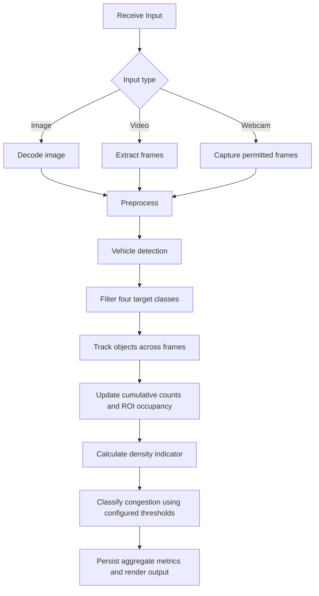
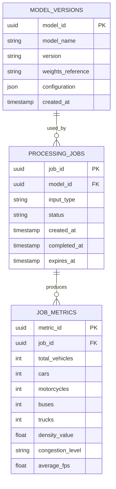
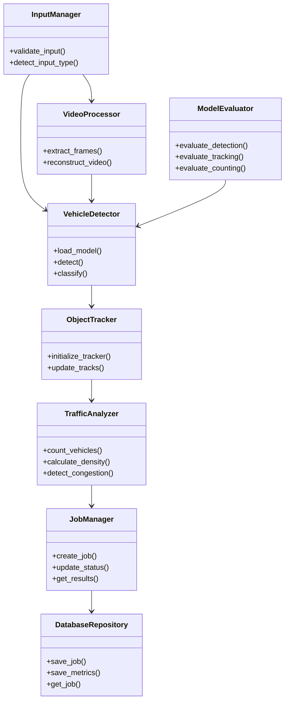
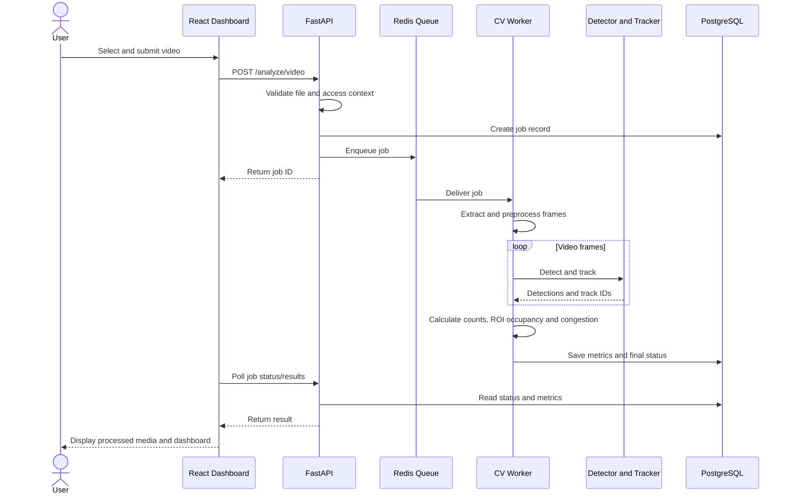

# Technical Architecture — Intelligent Traffic Monitoring System

| Field | Value |
|---|---|
| Architecture version | 1.0 |
| Status | **Approved by project owner** |
| Approval date | 2026-11-18 |
| Baseline | Approved SRS v1.0 |
| Repository | adhishmodi/Test |
| Scope | Initial academic / portfolio release |

## 1. Purpose and design principles

This document defines the approved technical architecture for the Intelligent Traffic Monitoring System. It translates the approved SRS into a technology, component, data, API, security, deployment and quality design.

Design principles:
- Keep the application modular and understandable for an academic project.
- Separate HTTP request handling from computationally expensive video inference.
- Keep the application hosting-independent until measured benchmarks inform provider selection.
- Avoid mandatory user accounts in the initial release.
- Do not retain raw footage by default.
- Record measured model and runtime performance; do not promise unverified accuracy or real-time throughput.
- Preserve the approved SRS as the requirements baseline.

## 2. Approved architecture decisions

| Area | Approved decision |
|---|---|
| Frontend | React + TypeScript |
| Backend | Python + FastAPI |
| ML framework | PyTorch |
| Detector | Benchmark a suitable pretrained YOLO-family candidate; exact model/version remains subject to licensing and benchmark review |
| Tracking | ByteTrack as the initial candidate; compare with BoT-SORT on representative footage |
| Image/video processing | OpenCV |
| Database | PostgreSQL |
| Background processing | Redis-backed queue and separate Python worker, subject to deployment feasibility |
| Training | Google Colab for GPU-dependent fine-tuning |
| Development | GitHub Codespaces |
| Public hosting | **Defer provider selection until benchmarking** |
| Authentication | No mandatory login in the initial release |
| Storage | Private temporary object storage for inputs/outputs; expiry and deletion policy required |

## 3. Technology evaluation

### 3.1 Application stack

| Concern | Considered options | Recommendation and rationale |
|---|---|---|
| Language | Python, Java | Python: strongest fit with the selected CV/ML ecosystem |
| Deep learning | PyTorch, TensorFlow | PyTorch: suitable training and inference ecosystem |
| Detection | YOLO family, RT-DETR, Faster R-CNN | Benchmark a YOLO-family candidate first; compare accuracy, speed, hardware use and licensing |
| Tracking | ByteTrack, BoT-SORT, DeepSORT | ByteTrack initial candidate; benchmark BoT-SORT as an alternative |
| CV processing | OpenCV, Pillow | OpenCV for frame extraction, transformations and video I/O |
| Backend | FastAPI, Flask, Django | FastAPI for typed request validation, async endpoints and OpenAPI |
| Frontend | React, Streamlit, Gradio | React + TypeScript for a more flexible interactive dashboard |
| Database | SQLite, PostgreSQL | PostgreSQL for deployed job metadata and metrics |
| Job queue | In-process, Celery/RQ with Redis | Redis-backed asynchronous jobs to keep video processing out of API request handlers |
| Testing | unittest, pytest | pytest for unit, integration and API tests |

### 3.2 Model and licensing gate

The exact detector, package, model size and version are not yet locked. Before selection:
1. Verify the software/package license and the model-weight license independently.
2. Review obligations for the intended public repository and deployment.
3. Compare candidate performance on a representative validation set and target hardware.
4. Record the selected versions, provenance and configuration.

Ultralytics licensing options and obligations must be reviewed before adopting an Ultralytics-based implementation. If the available license is incompatible with the intended distribution or use, evaluate an alternative detector/framework. No model/package license is presumed approved by this architecture record.

## 4. High-level architecture

The system uses a React client, FastAPI application, asynchronous processing queue, independent CV worker, analytics services and PostgreSQL metadata store.



### 4.1 Responsibilities

1. **Input:** image/video upload and browser webcam capture.
2. **Presentation:** upload controls, progress, processed media and analytics dashboard.
3. **API:** validation, job creation, job access and result retrieval.
4. **Processing:** frame extraction, detector inference and object tracking.
5. **Analytics:** cumulative counts, current ROI occupancy, density indicator and congestion level.
6. **Persistence:** job metadata, aggregated metrics and model-version metadata.
7. **Operations:** configuration, logging, temporary-file expiry, monitoring and deployment.

### 4.2 Processing flow



## 5. Module breakdown

| Module | Main responsibility |
|---|---|
| Frontend dashboard | Uploads, live view, result display, charts and export |
| Input manager | Input type detection and request coordination |
| File validator | File signature, supported format, size and duration checks |
| Video processor | Frame extraction, timestamp handling and output reconstruction |
| Image processor | Decode, resize and model-specific preprocessing |
| Vehicle detector | Detect car, motorcycle, bus and truck |
| Object tracker | Associate detections and maintain track IDs |
| Vehicle counter | Cumulative unique counts and class-wise counts |
| Density analyzer | ROI-based image-space occupancy/density indicator |
| Congestion analyzer | Configurable low/moderate/high classification |
| Job manager | Create jobs, status, progress, failures and cancellation policy |
| Results service | Aggregate and return analysis metrics |
| Export service | Downloadable summary/report |
| Model evaluator | Detection, tracking, counting, congestion and runtime evaluation |
| Persistence layer | Store job metadata, metrics and model versions |

### 5.1 Detection record

Each detection should carry:
- frame index and timestamp;
- class ID and class name;
- confidence score;
- bounding box coordinates `x1, y1, x2, y2`;
- tracker-generated `track_id`, when available.

The detector does not itself guarantee persistent IDs; the tracking component assigns and updates them.

## 6. Machine-learning and analytics design

### 6.1 Training workflow

1. Research candidate datasets and their terms of use.
2. Inspect annotation schema, class definitions and scene coverage.
3. Map annotations to car, motorcycle, bus and truck.
4. Split training, validation and held-out test data; avoid related-video leakage where practical.
5. Establish pretrained baseline metrics.
6. Fine-tune in Google Colab using a recorded configuration.
7. Evaluate on held-out data.
8. Compare model size, accuracy, latency, memory and throughput.
9. Export and register the selected model artifact.
10. Integrate inference and run application-level validation.

Potential datasets for investigation include BDD100K, UA-DETRAC and MIO-TCD. These are candidates only; suitability, class mapping, access and licensing must be verified before use.

### 6.2 Tracking

ByteTrack is the initial candidate due to its relatively efficient association workflow. BoT-SORT is the comparison candidate. Evaluate IDF1, HOTA or MOTA where dataset annotations and evaluation tooling support them. Document ID switches and failure cases.

### 6.3 Counting semantics

Keep distinct:
- **Cumulative count:** number of unique tracked vehicles counted over the clip, using a documented counting policy (e.g. track entry/crossing).
- **Current occupancy:** number of currently active tracked vehicles inside the configured ROI.

Do not treat repeated frame detections as separate vehicles.

### 6.4 Density and congestion

For an image-space ROI:
`D = N_{ROI} / A_{ROI}`

A normalized indicator may be:
`D_n = (N_{ROI} / A_{ROI}) × 1000`

Here, `N_ROI` is current tracked occupancy and `A_ROI` is ROI area in image coordinates. This is not a calibrated physical density (vehicles/km or vehicles/km²).

Congestion initially uses configurable thresholds:
- below `T1`: low;
- from `T1` to below `T2`: moderate;
- at or above `T2`: high.

Thresholds must be calibrated and evaluated on representative scenarios. Camera angle, ROI geometry and perspective affect interpretation.

### 6.5 Evaluation

Report:
- detection precision, recall, mAP@0.5 and mAP@0.5:0.95;
- tracking IDF1/HOTA/MOTA where supported;
- count mean absolute error;
- congestion confusion matrix and per-class precision/recall;
- inference latency, FPS, peak memory and hardware details.

Set target values after baseline benchmarking. Never report illustrative values as measured outcomes.

## 7. Data model

No account/user table is required in the initial release. The proposed logical entities are:

### 7.1 processing_jobs

| Column | Type | Notes |
|---|---|---|
| job_id | UUID | Primary key |
| model_id | UUID | Foreign key to model_versions |
| input_type | VARCHAR | image, video or webcam |
| status | VARCHAR | queued, processing, completed, failed, expired |
| created_at | TIMESTAMP | Creation time |
| completed_at | TIMESTAMP nullable | Completion time |
| error_message | TEXT nullable | Sanitized failure summary |
| progress | SMALLINT nullable | 0–100 where available |
| expires_at | TIMESTAMP | Retention deadline |

### 7.2 job_metrics

| Column | Type | Notes |
|---|---|---|
| metric_id | UUID | Primary key |
| job_id | UUID | Foreign key to processing_jobs |
| total_vehicles | INTEGER | Cumulative unique count |
| cars | INTEGER | Car count |
| motorcycles | INTEGER | Motorcycle count |
| buses | INTEGER | Bus count |
| trucks | INTEGER | Truck count |
| density_value | DOUBLE PRECISION | Documented image-space indicator |
| congestion_level | VARCHAR | low, moderate or high |
| average_fps | DOUBLE PRECISION nullable | Measured processing throughput |

### 7.3 model_versions

| Column | Type | Notes |
|---|---|---|
| model_id | UUID | Primary key |
| model_name | VARCHAR | Model identifier |
| version | VARCHAR | Immutable version label |
| weights_reference | VARCHAR | Artifact reference, not raw weights in DB |
| configuration | JSONB | Model and inference configuration |
| created_at | TIMESTAMP | Registration time |

### 7.4 Entity relationship



Implementation detail: enforce referential integrity, index job status/creation/expiry fields, and define whether one job produces one final aggregate row or multiple time-window metric rows. The initial design can use one final aggregate row per job.

## 8. API specification

Base path: `/api/v1`. Exact schemas, status codes, limits and streaming mechanics are to be finalized during P3.

| Method | Endpoint | Purpose |
|---|---|---|
| GET | `/health` | Health/readiness check |
| POST | `/analyze/image` | Submit image job |
| POST | `/analyze/video` | Submit video job |
| POST | `/analyze/webcam` | Create webcam session where supported |
| GET | `/jobs/{job_id}` | Read job status/progress |
| GET | `/jobs/{job_id}/results` | Read analysis summary |
| GET | `/jobs/{job_id}/video` | Retrieve processed video while retained |
| GET | `/statistics/{job_id}` | Read traffic statistics |
| GET | `/models` | List available model versions |
| GET | `/evaluation` | Read evaluation report/metadata |
| DELETE | `/jobs/{job_id}` | Delete job and associated temporary data |

### 8.1 Example submission

`POST /api/v1/analyze/video` — multipart form containing the video file and optional model/version selection.

Example response:
```json
{
  "job_id": "a1234567-1234-1234-1234-123456789012",
  "status": "queued"
}
```

### 8.2 Example status

`GET /api/v1/jobs/{job_id}`
```json
{
  "job_id": "a1234567-1234-1234-1234-123456789012",
  "status": "processing",
  "progress": 65
}
```

### 8.3 Example result

`GET /api/v1/jobs/{job_id}/results`
```json
{
  "total_vehicles": 120,
  "vehicle_counts": {
    "cars": 75,
    "motorcycles": 25,
    "buses": 8,
    "trucks": 12
  },
  "density": 15.4,
  "congestion": "moderate",
  "average_fps": 18.5
}
```

These are schema illustrations only, not benchmark results.

FastAPI provides OpenAPI documentation at `/docs`, `/redoc` and `/openapi.json`.

## 9. Authentication and authorization

Mandatory registration/login is not part of the initial release.

- Public users may submit analysis subject to quotas and abuse controls.
- Job access must be scoped to the submitting browser session or an opaque, high-entropy, short-lived job-access token.
- A UUID is an identifier, not by itself a sufficient authorization mechanism.
- Administrative/operational endpoints must be protected.
- Workers use internal service credentials and must not be exposed directly to the public internet.
- If accounts are later required, authentication is a separately scoped decision.

## 10. Security and privacy

| Threat | Control |
|---|---|
| Malicious uploads | Verify file signatures/content; allowlist formats |
| Oversized or malformed media | Enforce size, duration, dimensions and decode limits |
| Path traversal | Generate server-side filenames; never trust upload paths |
| Resource exhaustion | Bounded frame batches, worker concurrency and execution limits |
| Job data disclosure | Session/job-scoped access tokens |
| API abuse | Rate limits, quotas and request limits |
| Temporary media leakage | Private storage, short-lived access and automated deletion |
| Secret exposure | Environment variables/secret manager; no secrets in Git |
| Dependency compromise | Pin dependencies, scan and review updates |
| Webcam privacy | Explicit user action and browser permission; no capture without consent |

Raw uploaded footage and webcam frames are not retained by default. Temporary input and output artifacts require documented expiry, deletion on job removal and cleanup of abandoned/failed jobs. Logs must not contain raw frames, full media payloads or secrets. Use HTTPS in public deployment.

## 11. Scalability and performance

Separate API and inference worker workloads. The API validates input, creates a job and returns quickly. A queue distributes jobs to one or more workers. The initial deployment may use one worker; add concurrency only after load and memory benchmarks.

Optimization options:
- appropriate model size and input resolution;
- bounded frame sampling/batching;
- load model once per worker process;
- avoid repeated model initialization;
- release frame buffers and temporary artifacts;
- efficient codecs and output resolution;
- polling or server-sent updates for job progress;
- configurable worker concurrency and job timeouts.

## 12. Deployment architecture and feasibility

### Development
- GitHub Codespaces for application development and lightweight CPU inference.
- Docker Compose may provide local API, frontend, Redis and PostgreSQL services.
- Google Colab for GPU-dependent training.
- Do not assume a Codespaces GPU.

### Public deployment
Provider selection is intentionally deferred until benchmarking. Candidate hosting arrangements may include a general application platform with separate worker and managed database, or an ML-focused hosting platform. The selected provider must be tested for:
- CPU/GPU availability and cost;
- RAM and temporary disk limits;
- request and worker execution limits;
- upload size and duration limits;
- persistent database/storage pricing;
- concurrency and cold-start behavior;
- webcam latency and sustained throughput.

Keep deployment configuration provider-neutral where practical. A free-tier deployment is a demonstration, not a production reliability commitment. Do not claim real-time performance until measured on the actual deployment.

## 13. Proposed class and sequence relationships

### Main classes



### Video job sequence



## 14. Proposed repository structure

```text
Test/
├── README.md
├── PROJECT_BRIEF.md
├── SRS.md
├── ARCHITECTURE.md
├── DECISIONS.md
├── TASKS.md
├── CHANGELOG.md
├── TEST_REPORT.md
├── DEPLOYMENT.md
├── .gitignore
├── .env.example
├── docker-compose.yml
├── pyproject.toml
├── frontend/
│   ├── public/
│   └── src/
│       ├── components/
│       ├── pages/
│       ├── services/
│       ├── hooks/
│       ├── charts/
│       └── types/
├── backend/
│   └── app/
│       ├── api/v1/
│       ├── core/
│       ├── schemas/
│       ├── models/
│       ├── services/
│       ├── repositories/
│       ├── workers/
│       ├── database/
│       └── main.py
├── ml/
│   ├── detection/
│   ├── tracking/
│   ├── analytics/
│   ├── evaluation/
│   └── inference/
├── training/
│   ├── configs/
│   ├── datasets/
│   ├── scripts/
│   └── notebooks/
├── models/
├── tests/
│   ├── unit/
│   ├── integration/
│   ├── api/
│   └── e2e/
├── scripts/
├── .devcontainer/
├── .github/workflows/
└── docs/
    ├── diagrams/
    ├── screenshots/
    └── user-guide/
```

Datasets, generated videos, secrets and large model weights should not be committed directly to Git. Use documented external artifact storage or release assets as appropriate.

## 15. Risks and mitigations

| Risk | Impact | Mitigation / gate |
|---|---|---|
| No local GPU | High | Train/fine-tune in Colab; CPU baseline for development |
| Public CPU inference too slow | High | Benchmark model sizes, resolution and frame sampling |
| Dataset class mismatch or license issue | High | Inspect annotations and verify terms before adoption |
| Model/package licensing incompatibility | High | Complete license review before selecting dependency |
| Occlusion and lighting degrade detection | High | Representative validation, fine-tuning and limitations report |
| Tracking ID switches | Medium/High | Compare ByteTrack and BoT-SORT |
| Large uploads / resource exhaustion | High | Strict limits, async jobs and bounded processing |
| Webcam latency/hosting constraints | High | Benchmark capture-to-result latency on target hosting |
| Density thresholds are arbitrary | High | Define ROI and calibrate thresholds on labeled scenarios |
| Temporary files persist unexpectedly | High | Expiry, deletion tests and scheduled cleanup |
| Hosting costs exceed expectations | Medium | Benchmark and estimate before provider approval |

## 16. Acceptance and traceability

Architecture components map to the approved SRS:
- FR-01 to FR-03: input manager and image/video/webcam workflows.
- FR-04 to FR-07: detector, class filtering, overlays and tracker.
- FR-08 to FR-10: counting, ROI density and congestion analyzer.
- FR-11 to FR-13: dashboard, processed media and export.
- FR-14 to FR-15: validation, error handling and job progress.
- FR-16: evaluation module and report.
- NFRs: security, privacy, reproducibility, portability, performance and maintainability controls in this document.

Implementation acceptance targets and numerical performance thresholds remain to be defined from baseline measurements and the P3/P5 design work.

## 17. Approval record

On 2026-11-18, the project owner approved the proposed architecture with these explicit choices:
- Frontend: React + TypeScript.
- Hosting: choose only after benchmarking.
- Database: PostgreSQL.
- Authentication: no mandatory login initially.
- General approval: approve the proposed architecture subject to documented risks and licensing review.

This approval authorizes architecture documentation and subsequent planning. It does **not** authorize implementation, dependency installation, database changes, production configuration changes or deployment. Those require separate approval under the project workflow.

**Architecture status: APPROVED — implementation not authorized.**
